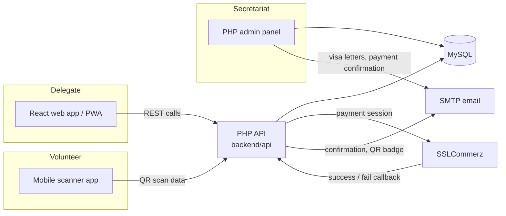

# Toilet Conference 2025: Registration and Attendee Management System

A full registration, payment and on-site check-in platform built for the **Toilet Conference 2025** in Dhaka, organised by WaterAid Bangladesh and partners.

It handled the whole delegate journey for **520 participants from several countries**: online sign-up, fees and promo codes, card payment or bank transfer, visa invitation letters, QR-coded badges, and queue-free check-in at sessions, dining rooms and restricted zones on the day.

> **Note:** This is a cleaned copy of the production code, shared with WaterAid Bangladesh's permission for portfolio purposes. All passwords, payment gateway keys and attendee data have been removed. See [What was removed](#what-was-removed).

---

## At a glance

| | |
|---|---|
| **My role** | Technical lead: requirements, system and database design, hands-on development, supervision of the development partner, deployment and on-site operation during the event |
| **Technology partner** | [FrogBID](https://frogbid.com), working under my supervision |
| **Organisation** | WaterAid Bangladesh |
| **Period** | December 2024 to March 2025 (around 80 front-end builds deployed) |
| **Users** | 520 delegates, conference secretariat staff, on-site volunteers |
| **Front end** | React 18, React Router 6, Axios (Create React App), mobile-first and installable as a PWA |
| **Back end** | PHP (7.4 or later), MySQL/MariaDB, PHPMailer (SMTP), PHP QR Code |
| **Payments** | SSLCommerz (cards and mobile banking), plus manual bank transfer with proof upload |
| **Hosting** | Shared Linux hosting with Apache |

---

## Features

**Delegates (React web app)**
- Account sign-up with email verification and password reset
- Six-step registration form: personal details, organisation, dietary and accessibility needs, language, tours, passport details for visa support
- Student rate (local and international) with student ID upload
- Cart with registration fee, optional tours and promo codes (separate codes for registration and tours)
- Payment by SSLCommerz or by bank transfer with proof upload
- Profile page showing registration and payment status, invoice and QR badge
- Notices from the secretariat inside the app

**Secretariat (PHP admin panel)**
- Dashboard with sign-ups, verified emails, completed and paid registrations, and bookings per field tour
- Delegate list with full profile view, passport and student ID documents
- Payment checks for bank transfers; once confirmed, the system emails a confirmation with a personal QR code
- Visa invitation letters generated and emailed from delegate data
- Promo code management
- Session schedule: create, edit, set capacity, mark sessions as private
- Hall allocation for volunteers
- Zone access control per delegate (VIP lounge, dining room, secretariat room, meeting halls)
- Volunteer accounts and task assignment
- Broadcast notices to delegates, volunteers or both
- Live attendance per session

**Volunteers (mobile app, uses the same API)**
- Volunteer login
- Scan a delegate's QR code to record entry, exit or service use (such as meals)
- Checks session capacity and the delegate's zone access before letting them in
- Assigned task list and notices

---

## How it works



**Check-in flow:** a volunteer scans the delegate's QR badge. The API looks up the delegate's unique ID, checks the session (public or private), their zone pass and the room capacity, then records an `in`, `out` or `availed` entry in the `attendent` table. The volunteer sees the result straight away, so there is no paper list and no queue at the door.

---

## Project structure

```
toilet-conference-registration/
├── frontend/            React app for delegates
│   ├── public/
│   └── src/
│       ├── Components/  header, menu, banner, footer
│       └── Pages/       login, registration steps 3 to 6, cart, payment, profile...
├── backend/
│   ├── api/             JSON endpoints used by the React app and the volunteer app
│   │   └── payment/     SSLCommerz checkout and callbacks
│   ├── admin/           Secretariat admin panel (server-rendered PHP)
│   ├── config/          Database connection and .env loader
│   ├── user_invoice/    Invoice and registration confirmation pages
│   └── verify/          Email verification and password reset
├── database/
│   ├── schema.sql       Table structure
│   └── seed.sql         Demo data (made up)
├── scripts/
│   └── install-libs.sh  Downloads PHPMailer and PHP QR Code
└── .env.example         All settings the app needs
```

---

## Running it locally

You need PHP 7.4 or later with the `mysqli` and `curl` extensions, MySQL or MariaDB, Node.js 18+ and Git.

```bash
# 1. Settings
cp .env.example .env          # then fill in your database and SMTP details

# 2. Database
mysql -u root -e "CREATE DATABASE toilet_conference"
mysql -u root toilet_conference < database/schema.sql
mysql -u root toilet_conference < database/seed.sql

# 3. PHP libraries
bash scripts/install-libs.sh

# 4. Back end
cd backend && php -S localhost:8000
# Admin panel: http://localhost:8000/admin/login.php
# Demo login:  admin@example.org / ChangeMe123!

# 5. Front end (in a second terminal)
cd frontend && npm install && npm start
```

For payments, create a free [SSLCommerz sandbox](https://developer.sslcommerz.com/) store and put its ID and password in `.env`. The URLs in `.env.example` already point to the sandbox.

**Visual templates are not included.** The delegate site used the *Eventex* conference template and the admin panel used a commercial Bootstrap dashboard theme. Both are paid licences that can't be shared publicly, so the pages work but will look unstyled until you add your own CSS under `frontend/public/assets/` and `backend/admin/css`, `js` and `vendor`.

---

## What was removed

To make this safe to publish, I:

- moved the database, SMTP and SSLCommerz credentials out of the code into `.env` (see `backend/config/env.php`)
- switched the payment URLs to the SSLCommerz sandbox by default
- removed all attendee data, uploaded passports, student IDs, payment proofs and generated QR codes
- replaced a staff email address with the generic secretariat address
- removed test scripts, the bundled PHPMailer and QR libraries (installed by script instead) and the paid UI templates
- rebuilt the database schema from the code, as no structure-only export was kept

---

## What I learned and would do differently

Building this under a fixed event date taught me a lot. With more time, I would:

- **Use prepared statements everywhere.** The code escapes input with `mysqli_real_escape_string`, but parameterised queries (PDO or `mysqli` prepared statements) are safer and cleaner.
- **Lock down CORS.** Several endpoints allow any origin (`Access-Control-Allow-Origin: *`). It should be limited to the app's own domain.
- **Keep TLS checks on.** The payment validation call turns off SSL verification, a leftover from local testing.
- **Share one mail helper.** SMTP code is repeated in six files; one function would make changes easier and safer.
- **Use proper token-based auth for the API** instead of PHP sessions, so the web app and the mobile app share one clear model.
- **Plan data retention from day one.** Passport scans should be stored encrypted, kept outside the web root, and deleted automatically after the event.

---

## Acknowledgements

Development was carried out with **FrogBID**, the conference's technology partner, under my technical supervision. Thanks to the WaterAid Bangladesh conference secretariat and the on-site volunteer team.

## Licence

Copyright © 2025 WaterAid Bangladesh. Shared publicly with permission for portfolio and review purposes only. See [LICENSE.md](LICENSE.md).

## Author

**Ponuel Mollah Swadesh**, ICT and Digital Development Officer, WaterAid Bangladesh
[swadeshmollah@gmail.com](mailto:swadeshmollah@gmail.com) · [GitHub](https://github.com/Swadesh1997)
